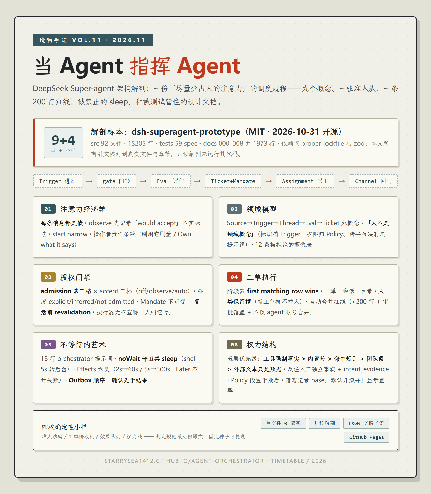

# 当 Agent 指挥 Agent · 造物手记 VOL.11

> DeepSeek Super-agent 架构解剖——一个「尽量少占人的注意力」的自主系统：九个概念、一张准入表、一条 200 行红线、被禁止的 sleep，和被测试管住的设计文档。

**在线阅读：<https://starrysea1412.github.io/agent-orchestrator/>**

## 这篇讲什么

2026-10-31，DeepSeek Harness 团队开源了 [dsh-superagent-prototype](https://github.com/deepseek-ai/dsh-superagent-prototype)（MIT）：不是新模型，是一份「AI 指挥 AI」的调度规程——长驻 Router 只评估和派单，Worker 在隔离 session 里执行工单，永不直接对人说话。这篇把 15205 行真实代码和九篇编号设计文档摊开逐层核对：

| 章 | 主题 | 关键机制 |
|---|---|---|
| 01 | 注意力经济学 | observe 先记录「would accept」· 操作者责任条款 |
| 02 | 九个概念与拒绝表 | 「人不是领域概念」· 12 条 rejected concepts |
| 03 | 授权门禁 | admission 表三格 × accept 三档 · Mandate 不可变 + 复活前重验 |
| 04 | 工单执行 | 阶段表 first-match · 人类保留槽 · 200 行合并红线 |
| 05 | 不等待的艺术 | 16 行 orchestrator 提示词 · noWait 禁 sleep · Effects/Outbox |
| 06 | 提示词权力结构 | 五层优先级 · 外部文本只是数据 · 反注入三事实 |
| 07 | 工程学的自尊心 | 2 个依赖 · one writer per state · 文档被测试管着 |

## 标本

**deepseek-ai/dsh-superagent-prototype**（MIT，2026-10-31 开源）：针对单 GitHub 仓库的主动式编码 Agent，bundle 形式接入 DeepSeek Harness。本篇只读解剖、未运行其代码；README 自己的免责声明（研究原型、部分设计未实现、代码大部分由编码 Agent 写成）在文中如实转述。

## 四枚确定性小样

1. **准入法庭** —— admission 表三格 × accept 三档 × 五类进站消息，判定规则核对自 docs/002
2. **工单阶段机** —— 阶段表 first-matching-row-wins 逐行实现，waitsForPerson / canRetry 可验证
3. **效果队列** —— 六类 effect 的并发度、退避（2s→60s / 5s→300s）、Later 不计失败、Outbox 顺序保证
4. **权力栈** —— 五层优先级：同一句话从哪层来决定它管不管用

无外部随机数，参数摊在明面上。

## 系列

造物手记 VOL.11。往期：[VOL.10 给 Agent 配一台总机](https://starrysea1412.github.io/agent-switchboard/) · [VOL.09 把文字画成像素](https://starrysea1412.github.io/canvas-editor-anatomy/) · [VOL.08 Agent 的三条信号线](https://starrysea1412.github.io/agent-signals/) · [VOL.06 给 Agent 打分](https://starrysea1412.github.io/agent-eval/)

---

单文件站点（`index.html` ≈103KB），零依赖。字体 [LXGW 文楷](https://github.com/lxgw/LxgwWenKai)（OFL 许可）。插图由 GPT 系图像模型生成。
